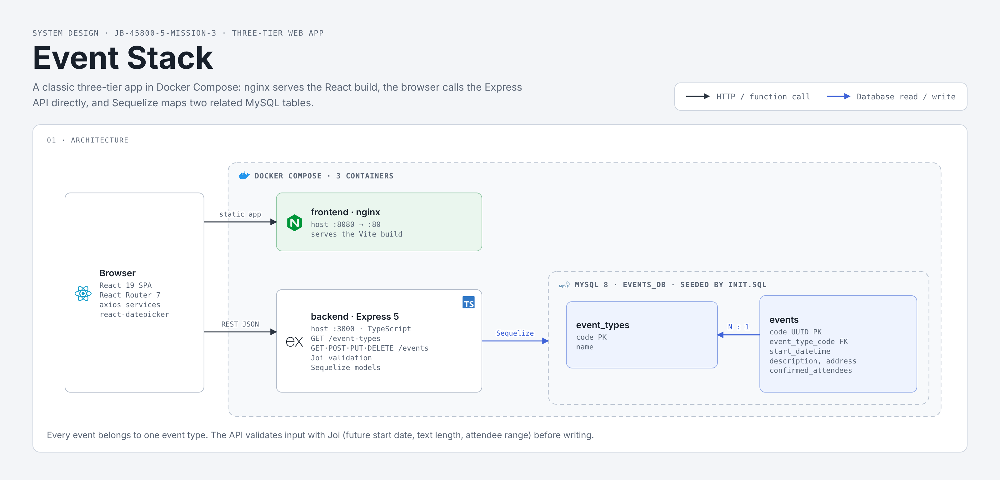

# Event Stack Management System

A full-stack events management web application. Manage events by type, browse upcoming and past events, and create or update event entries through a clean dark-themed UI.

---

## System design



## Tech Stack

| Layer | Technology |
|---|---|
| Database | MySQL 8.0 |
| Backend | Node.js · Express 5 · TypeScript · Sequelize ORM |
| Frontend | React · TypeScript · Vite · react-router-dom · axios |
| Containerization | Docker · Docker Compose |

---

## Quick Start

> Requires [Docker Desktop](https://www.docker.com/products/docker-desktop/)

```bash
git clone <repo-url>
cd jb-45800-5-mission-3
docker compose up --build
```

| Service | URL |
|---|---|
| Frontend | http://localhost:8080 |
| Backend API | http://localhost:3000 |
| Database | localhost:3306 |

To stop all containers:

```bash
docker compose down
```

---

## Project Structure

```
├── database/
│   ├── Dockerfile          # MySQL 8.0 image
│   └── init.sql            # Schema creation + seed data
│
├── backend/
│   ├── config/
│   │   ├── default.json    # Local dev config
│   │   └── compose.json    # Docker Compose overrides
│   ├── src/
│   │   ├── app.ts          # Entry point (Express setup)
│   │   ├── db/             # Sequelize connection
│   │   ├── models/         # EventType, Event (Sequelize models)
│   │   ├── routers/        # event-types, events routes
│   │   ├── controllers/    # Business logic + Joi validators
│   │   └── middlewares/    # Validation, error handling, not-found
│   ├── api/
│   │   └── events.postman_collection.json
│   └── Dockerfile
│
├── frontend/
│   ├── public/             # Static assets (logo, favicon)
│   ├── src/
│   │   ├── components/
│   │   │   ├── app/        # App root + global layout
│   │   │   ├── home/       # Home page
│   │   │   ├── about/      # About page
│   │   │   ├── layout/     # Header, nav, router outlet
│   │   │   └── events/
│   │   │       ├── list/   # EventsList (browse + filter)
│   │   │       └── form/   # AddEvent, UpdateEvent, DateTimePicker,
│   │   │                   # validateEventForm, EventForm.css
│   │   ├── models/         # TypeScript interfaces
│   │   └── services/       # Axios service classes
│   └── Dockerfile          # Vite build → nginx
│
└── docker-compose.yaml
```

---

## Database Schema

### `event_types`
| Column | Type | Notes |
|---|---|---|
| `code` | VARCHAR | Primary key (e.g. `wedding`, `birthday`) |
| `name` | VARCHAR | Display name |

### `events`
| Column | Type | Notes |
|---|---|---|
| `code` | CHAR(36) UUID | Primary key |
| `event_type_code` | VARCHAR | FK → `event_types.code` |
| `start_datetime` | DATETIME | Must be a future date |
| `description` | VARCHAR | 2–200 characters |
| `address` | VARCHAR | 2–200 characters |
| `confirmed_attendees` | INT | 0–1000 |

Seed data includes 5 event types: `wedding`, `party`, `conference`, `company_event`, `birthday`.

---

## REST API

Base URL: `http://localhost:3000`

### Event Types

| Method | Path | Description |
|---|---|---|
| GET | `/event-types` | Get all event types |

### Events

| Method | Path | Description |
|---|---|---|
| GET | `/events?typeCode=<code>` | Get events filtered by type |
| GET | `/events/all` | Get all events |
| GET | `/events/:code` | Get a single event by UUID |
| POST | `/events` | Create a new event |
| PUT | `/events/:code` | Update an existing event |
| DELETE | `/events/:code` | Delete an event |

#### POST / PUT body

```json
{
  "eventTypeCode": "birthday",
  "startDatetime": "2026-08-15T18:00:00.000Z",
  "description": "Summer birthday bash",
  "address": "123 Main St, Tel Aviv",
  "confirmedAttendees": 30
}
```

A Postman collection is available at `backend/api/events.postman_collection.json`.

---

## Frontend Pages

| Route | Page | Description |
|---|---|---|
| `/` | Home | Landing page with quick-navigation cards |
| `/about` | About | System overview and tech stack |
| `/events` | Events List | Browse events, filter by type, edit or delete |
| `/events/add` | Add Event | Form to create a new event |
| `/events/update/:code` | Update Event | Pre-filled form to edit an existing event |

Events in the past are displayed in gray; upcoming events are highlighted in green with a days-until badge.
